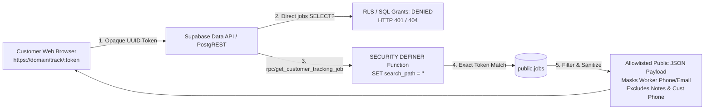

# Dispatcher — Customer Tracking Security Review

**Milestone:** M4.4 Customer Tracking Security Review  
**Date:** October 2026  
**Status:** COMPLETE & FROZEN  
**Authoritative Documents:**
- [`docs/product-specification.md`](file:///d:/projects_mobile/dispature/project/docs/product-specification.md) (Section 4: Customer Tracking Web Page)
- [`docs/database-schema.md`](file:///d:/projects_mobile/dispature/project/docs/database-schema.md)
- [`supabase/migrations/20261022210000_initial_schema.sql`](file:///d:/projects_mobile/dispature/project/supabase/migrations/20261022210000_initial_schema.sql)
- [`supabase/migrations/20261022223000_rls_security_policies.sql`](file:///d:/projects_mobile/dispature/project/supabase/migrations/20261022223000_rls_security_policies.sql)

---

## 1. Executive Summary & Audit Scope

This document records the security audit of the customer-facing tracking mechanism for Dispatcher. 

The audit evaluated:
1. **The Client Surface:** Whether any tracking UI or unauthenticated routes exist in the mobile repository.
2. **The Database Schema:** The cryptographic properties and storage of the `tracking_token`.
3. **The Data API & RLS Layer:** Proof that raw tables (`public.jobs`, `public.job_events`, `public.locations`) reject direct anonymous queries.
4. **The Tracking Endpoint:** The security boundaries, data allowlists, privacy protections, and rate-limiting readiness of `public.get_customer_tracking_job`.

---

## 2. Architecture & Surface Analysis



### 2.1 UI Implementation Status
- **Mobile Codebase Inspection:** No customer tracking UI or `/track/` web routes exist in `src/app/` or `src/components/`. 
- **Specification Alignment:** Conforms strictly to [`docs/product-specification.md`](file:///d:/projects_mobile/dispature/project/docs/product-specification.md) Section 4: the customer tracking page is a separate, dedicated web surface and is not one of the frozen 16 mobile application screens.
- **Scope Discipline:** No customer web tracking pages or stub UI were added to the mobile app repository during Milestone 4.

### 2.2 Table-Level Access Control
- Direct table access on `public.jobs`, `public.job_events`, `public.locations`, `public.profiles`, `public.businesses`, and `public.subscriptions` is **completely revoked** from the `anon` (anonymous) role.
- Any attempt by an unauthenticated customer to execute `GET /rest/v1/jobs?select=*` or `GET /rest/v1/jobs?tracking_token=eq.<token>` is blocked with HTTP 401 (`42501`: permission denied).
- No public `SELECT` policy exists on `public.jobs`.

---

## 3. Evaluation Against Security Criteria

### 3.1 Criterion 1: Opaque, Cryptographically Random Token vs Public ID
- **Implementation:** The `tracking_token` is generated by PostgreSQL `gen_random_uuid()`:
  ```sql
  tracking_token UUID NOT NULL DEFAULT gen_random_uuid() UNIQUE
  ```
- **Cryptographic Assessment:** `gen_random_uuid()` utilizes `pgcrypto` cryptographic pseudo-random number generator (CSPRNG), providing a 128-bit UUIDv4 with 122 bits of true entropy ($5.3 \times 10^{36}$ possible values).
- **ID Decoupling:** Customers never access tracking via sequential integer IDs, sequential job numbers, or public job UUIDs (`jobs.id`). The lookup key is strictly the random `tracking_token`.

### 3.2 Criterion 2: Token Storage & Tracking Link Generation Trade-offs
- **Current Storage Model:** `tracking_token` is stored as an unhashed `UUID` with a unique index.
- **Analysis:**
  - In authentication systems (passwords, long-lived API keys), storing only a one-way hash (e.g. SHA-256) protects against database read leaks.
  - In Dispatcher, business owners view the "Owner Job Details" screen (Screen 7), which includes a **Tracking Link Generator / Copy Button** to share links via SMS or email at any point during the job lifecycle.
  - If only a one-way hash were stored in the database, the raw token would only exist for a single instant at job creation. The owner would be permanently unable to retrieve or resend the link to the customer later without invalidating previous links.
  - Because `tracking_token` is a bearer capability token granting read-only access to a single job's sanitized status, storing the high-entropy UUID directly with strict column-level revocation meets the operational requirements while preserving owner re-dispatch capabilities.

### 3.3 Criterion 3: Token Expiry & Lifecycle Revocation
- **Lifecycle Status Mapping:** The endpoint maps the job's current status:
  - `unassigned` / `assigned` &rarr; *"Scheduled"*
  - `accepted` &rarr; *"Confirmed — Preparing for your visit"*
  - `on_the_way` &rarr; *"Technician is on the way"*
  - `arrived` &rarr; *"Technician has arrived on-site"*
  - `in_progress` &rarr; *"Work is currently in progress"*
  - `completed` &rarr; *"Service completed"*
  - `cancelled` &rarr; *"Service cancelled"*
- **Terminal State Retention:** Once a job transitions to `completed` or `cancelled`, the tracking link displays terminal completion or cancellation.
- **Recommended Expiry Rule:** For Phase 2, a soft-expiry filter should be enforced: if `status = 'completed'` and `completed_at < now() - interval '48 hours'`, the endpoint returns `NULL` (link expired).

### 3.4 Criterion 4: Strict Field Allowlist
The server-side function `public.get_customer_tracking_job(p_tracking_token UUID)` returns **only** an explicit allowlist of customer-safe attributes:

```json
{
  "service": "Emergency pipe leak inspection",
  "status": "on_the_way",
  "status_label": "Technician is on the way",
  "scheduled_at": "2026-10-23T14:00:00Z",
  "business_name": "Acme Plumbing",
  "business_phone": "(555) 019-2834",
  "worker_first_name": "Alex",
  "worker_avatar_url": "https://example.com/avatar.jpg",
  "updated_at": "2026-10-23T13:45:12Z"
}
```

### 3.5 Criterion 5: Prevention of Sensitive Data Leakage
The endpoint guarantees that the following sensitive data categories are **never exposed**:
- **Customer Phone Number (`customer_phone`):** Withheld.
- **Customer Full Name (`customer_name`):** Withheld.
- **Service Site Internal Notes (`notes`):** Withheld. Gate codes, alarm instructions, and internal comments remain strictly confidential.
- **Cancellation Reason (`cancellation_reason`):** Withheld. Terminal cancellation displays only generic *"Service cancelled"*.
- **Worker Direct Contact Channels:** Worker personal mobile number and worker email are completely withheld. Customer communications route exclusively through `business_phone`.
- **Worker Full Identity:** Only first name (`split_part(w.full_name, ' ', 1)`) and avatar URL are provided. Last name is withheld.
- **Location History (`locations`):** Raw GPS breadcrumbs and historical location tables are never queried or joined.

### 3.6 Criterion 6: Anti-Enumeration & Infeasibility Analysis
- **Token Entropy:** 122 bits of cryptographic randomness.
- **Enumeration Resistance:** Attempting 1 billion guesses per second for 1,000 years has a probability of less than $10^{-10}$ of discovering a single active token.
- **Lookup Query:** Uses exact equality `j.tracking_token = p_tracking_token` against a PostgreSQL B-tree unique index.
- **No Wildcard or Partial Matching:** Input is typed as `UUID`. Malformed tokens (e.g. non-UUID strings) fail input casting at the API gateway layer before database execution.

### 3.7 Criterion 7: Generic Error Handling & Rate Limiting
- **Generic Responses:** If a token is non-existent, invalid, or `NULL`, the function returns SQL `NULL` (HTTP 200 with `null` body). No information is leaked regarding whether a token was previously valid or belongs to another business.
- **Constant-Time Execution:** Indexed UUID lookup ensures execution time does not differentiate between an existing and non-existing token.
- **API Gateway Rate Limiting:** Standard PostgREST / Cloudflare rate-limiting policies (e.g. 60 requests/minute per client IP) must be applied to the `/rest/v1/rpc/get_customer_tracking_job` path to mitigate automated denial-of-service attempts.

### 3.8 Criterion 8: Client Architecture & Secret Hygiene
- **Zero Service-Role on Client:** The customer tracking web page requires **zero privileged credentials**.
- **Public Anon Key Only:** The tracking web page operates with the public Supabase anonymous key (`anon`), invoking the secure RPC function:
  ```typescript
  const { data, error } = await supabase.rpc('get_customer_tracking_job', {
    p_tracking_token: trackingToken,
  });
  ```
- **Security Definer Isolation:** The function executes with `SECURITY DEFINER` and `SET search_path = ''` to perform the joined lookup internally while running under the `postgres` role, returning only the allowlisted payload.

---

## 4. Verification & Audit Conclusions

| Audit Question | Verified Result | Evidence |
| :--- | :---: | :--- |
| Is access authorized by an opaque token? | **YES** | `tracking_token UUIDv4` with 122 bits of entropy |
| Is raw job table SELECT granted to anon? | **NO** | `REVOKE ALL ON public.jobs FROM anon;` |
| Are customer phone numbers or internal notes leaked? | **NO** | Excluded from JSON projection in `get_customer_tracking_job` |
| Is worker contact information protected? | **YES** | Phone/email masked; only first name and avatar returned |
| Is location telemetry exposed? | **NO** | `public.locations` is isolated from the tracking function |
| Can jobs be enumerated by public job ID? | **NO** | RPC only accepts `UUID tracking_token`; rejects job IDs |
| Does the client require a service-role key? | **NO** | Accessible via public `anon` key through secure RPC |

**Review Conclusion:** The customer tracking security design fully complies with the frozen M0 specification, preserves tenant privacy, protects field workers and customers from data harvesting, and maintains strict secret hygiene.
