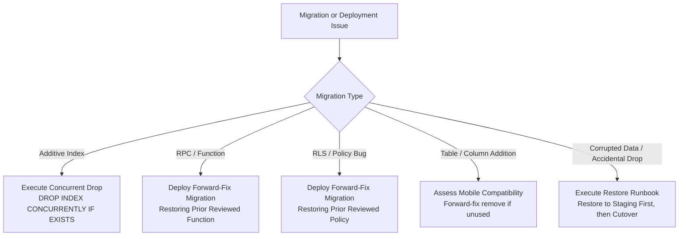

# Dispatcher — Database Backup, Restore & Migration Safety Runbook (M18.5)

## 1. Scope & Objective

This runbook defines the operational safety procedures for managing PostgreSQL migrations, executing backups, validating restores, and recovering from deployment failures in Dispatcher.

> [!IMPORTANT]
> **Operational Boundary Notice:**  
> This document specifies procedures for authorized human operators. Development AI assistants are strictly forbidden from executing migrations against remote environments, downloading production dumps, or accessing live production credentials. No backups were downloaded and no remote restorations were executed during this documentation task.

---

## 2. What Must Be Backed Up Before Risky Migrations

Before applying any migration that modifies table structures, alters constraints, or introduces new indexes:

1. **Schema & DDL Definitions:**
   - Full PostgreSQL public and helper schema (`app_auth`).
   - Extensions (`uuid-ossp`, `pgcrypto`).
   - RLS policies and table grants.
   - Database functions, triggers, and RPCs.
2. **Authoritative Business Data:**
   - Primary multi-tenant tables: `businesses`, `profiles`, `jobs`, `subscriptions`.
   - Append-only audit logs: `job_events`.
   - Telemetry: `locations`.
   - Security credentials: `customer_tracking_sessions`, `worker_invitations`, `device_tokens`, `notification_deliveries`.
3. **Ephemeral Tables (Optional):**
   - `rate_limit_buckets`: Rate-limit tracking buckets have a 60-second sliding expiration window; losing this table in a disaster recovery scenario only resets rate-limit counters without loss of business records.

---

## 3. How to Create Database Backups

Supabase projects on the Free plan do not include automated daily backups or Point-In-Time-Recovery (PITR). Operators must create manual, point-in-time snapshots prior to risky changes using standard tooling.

### Tooling Options

#### Option A: Supabase CLI (`supabase db dump`) — Recommended
Requires operator authentication via Supabase CLI (`supabase login`):

```bash
# 1. Dump full schema (DDL, functions, triggers, RLS policies)
supabase db dump --project-ref liuwoncaagppyezxugtt --schema-only -f pre_migration_schema_$(date +%Y%m%d_%H%M%S).sql

# 2. Dump data only (table contents, preserving relational rows)
supabase db dump --project-ref liuwoncaagppyezxugtt --data-only -f pre_migration_data_$(date +%Y%m%d_%H%M%S).sql

# 3. Create a unified custom-format compressed backup
supabase db dump --project-ref liuwoncaagppyezxugtt --format=custom -f backup_$(date +%Y%m%d_%H%M%S).dump
```

#### Option B: Native `pg_dump` via Direct Connection
When using direct PostgreSQL port connection (e.g., port 5432 or 6543 connection pooler):

```bash
# Export compressed binary archive with all public tables and app_auth schema
pg_dump \
  -h db.liuwoncaagppyezxugtt.supabase.co \
  -p 5432 \
  -U postgres \
  -d postgres \
  --format=custom \
  --schema=public \
  --schema=app_auth \
  --no-owner \
  --no-privileges \
  --file=dispatcher_pre_m18_$(date +%Y%m%d_%H%M%S).dump
```

---

## 4. Secure Storage of Backup Files

- **Prohibited:** Never commit SQL dumps, database backups, or `.dump` files to the Git repository, local sync folders, or unencrypted developer machines.
- **Approved Storage Locations:**
  1. **Encrypted Object Storage:** Dedicated private AWS S3 bucket or Google Cloud Storage bucket with:
     - Server-side KMS encryption (AES-256).
     - Bucket versioning enabled.
     - 30-day lifecycle expiration rule.
     - Block Public Access enabled at account level.
  2. **Transfer Command Example:**
     ```bash
     # Upload to private encrypted S3 bucket
     aws s3 cp backup_20261103.dump s3://dispatcher-prod-backups/database/ \
       --sse aws:kms \
       --sse-kms-key-id arn:aws:kms:region:account:key/dispatcher-db-backup-key
     
     # Securely shred local dump file after verification
     shred -u backup_20261103.dump
     ```

---

## 5. Credential Hygiene for Operators

- **Do Not Commit Passwords:** Never write PostgreSQL database passwords or service-role keys into `.env`, scripts, shell history, or documentation.
- **Approved Credential Supply Methods:**
  1. **Environment Variables via Secret Injection:**
     ```bash
     # Operator supplies password via interactive prompt or CLI vault injection
     read -s -p "Enter Database Password: " PGPASSWORD
     export PGPASSWORD
     # Run backup command...
     unset PGPASSWORD
     ```
  2. **1Password / AWS Secrets Manager:**
     ```bash
     op run -- pg_dump -h db.liuwoncaagppyezxugtt.supabase.co ...
     ```

---

## 6. Staging & Dev Environment Restoration Verification

> [!CAUTION]
> **Golden Rule of Restoration:**  
> Never test a database restore on a live production database. Always restore into a separate, isolated staging project or local development container first.

### Step-by-Step Restoration Procedure

#### 1. Prepare Staging Target
Create an isolated staging environment using a secondary Supabase project or local Docker container:
```bash
npx supabase start
```

#### 2. Restore Schema First
```bash
psql -h localhost -p 54322 -U postgres -d postgres -f pre_migration_schema_20261103.sql
```

#### 3. Restore Data
```bash
psql -h localhost -p 54322 -U postgres -d postgres -f pre_migration_data_20261103.sql
```

#### 4. Post-Restore Verification Checklist
Verify schema, constraints, data, and workflows in the restored environment:

- [ ] **Row Count Sanity Check:** Verify table row counts match production source:
  ```sql
  SELECT 'businesses', count(*) FROM public.businesses
  UNION ALL SELECT 'profiles', count(*) FROM public.profiles
  UNION ALL SELECT 'jobs', count(*) FROM public.jobs
  UNION ALL SELECT 'job_events', count(*) FROM public.job_events
  UNION ALL SELECT 'locations', count(*) FROM public.locations
  UNION ALL SELECT 'customer_tracking_sessions', count(*) FROM public.customer_tracking_sessions;
  ```
- [ ] **Foreign Key & Constraint Integrity:** Check that composite keys are intact:
  ```sql
  SELECT conname, conrelid::regclass, confrelid::regclass 
  FROM pg_constraint 
  WHERE conname IN ('jobs_worker_business_fk', 'uq_profiles_id_business', 'uq_locations_worker_job');
  ```
- [ ] **RLS Policy Verification:** Confirm RLS is enabled on all tables:
  ```sql
  SELECT tablename, rowsecurity FROM pg_tables WHERE schemaname = 'public';
  ```
- [ ] **Automated Test Suite:** Run local pgTAP test suites:
  ```bash
  npx supabase test db
  ```
- [ ] **Application Smoke Test:**
  - Owner signs in, loads Dashboard and Jobs list.
  - Worker signs in, loads Today tab and assigned jobs.
  - Public tracking URL loads customer tracking session.

---

## 7. Rollback & Forward-Fix Recovery Strategy (Part D)

Blindly generating destructive `DOWN` migrations (e.g. `DROP TABLE`, `DROP COLUMN`) is unsafe in production because it can permanently destroy business records or break running mobile app versions.

Dispatcher adopts a **forward-fix preference**:



### Recovery Matrix by Migration Type

| Migration Type | Potential Failure Mode | Approved Recovery Action | Risk Level |
| :--- | :--- | :--- | :--- |
| **Additive Index** (`CREATE INDEX`) | Index creation times out or lock contention occurs | Drop index using `DROP INDEX CONCURRENTLY IF EXISTS <name>;`. Zero data loss risk. | Very Low |
| **Database RPC / Function** (`CREATE OR REPLACE FUNCTION`) | Logic bug, permission rejection, or unexpected return contract | Deploy forward-fix migration redeploying the prior reviewed function definition from Git history. Do NOT drop the function. | Low |
| **RLS Policy Update** (`CREATE / ALTER POLICY`) | Legitimate owners or workers blocked from reading/writing | Deploy forward-fix migration re-applying the previous known-good policy definition. | Low |
| **Trigger Modification** (`CREATE OR REPLACE TRIGGER`) | Valid transitions rejected or events not logged | Deploy forward-fix migration restoring prior trigger logic. | Medium |
| **Table Schema Alteration** (New column / constraint) | Check constraint rejects existing records | Deploy forward-fix migration dropping or relaxing the constraint: `ALTER TABLE public.jobs DROP CONSTRAINT <constraint>;`. | Medium |
| **Catastrophic Failure** (Corrupted data / accidental drop) | Data loss or unrecoverable corruption | Follow Section 6: Restore verified backup into isolated environment, inspect data, and execute controlled cutover. | Critical |

---

## 8. Summary of Migration Discipline Rules

1. **Immutable Applied Migrations:** Never edit or delete migration files that have been merged or applied to any environment.
2. **Chronological Timestamp Naming:** Every new migration must use UTC timestamp prefix `YYYYMMDDHHMMSS_<descriptive_name>.sql`.
3. **Strict Additive Migrations:** Prefer additive changes (`CREATE ... IF NOT EXISTS`, nullable columns with defaults).
4. **Local Verification Before Remote:** Run `npx supabase test db` locally with Docker before any operator runs deployment commands.
5. **Never Apply Migrations Remotely in AI Sessions:** Remote deployments are performed exclusively by authorized operators through CI/CD or controlled CLI sessions.

