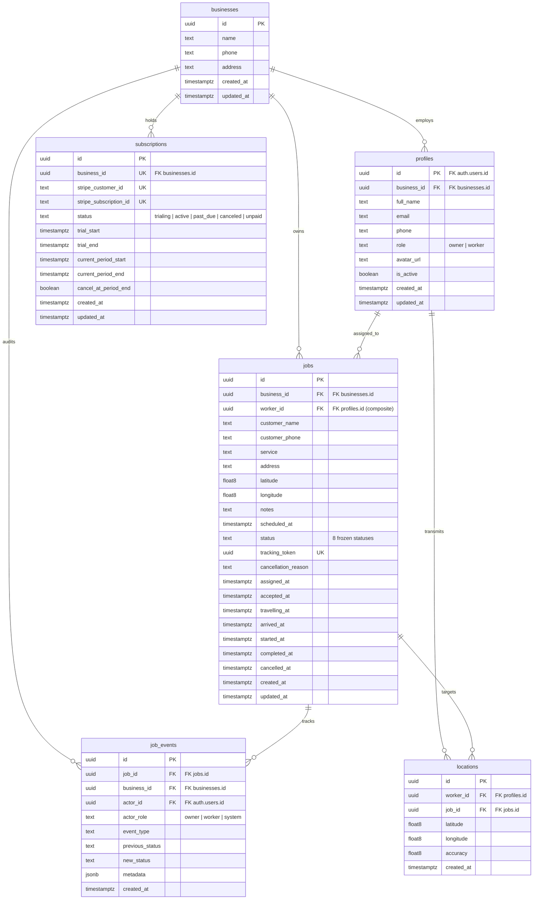

# Dispatcher — Database Schema Documentation

**Current Baseline:** M4.3 RLS Security & Lifecycle Policies Migration  
**Migration Files:**
- [`supabase/migrations/20261022210000_initial_schema.sql`](file:///d:/projects_mobile/dispature/project/supabase/migrations/20261022210000_initial_schema.sql) (M3 Baseline Schema)
- [`supabase/migrations/20261022223000_rls_security_policies.sql`](file:///d:/projects_mobile/dispature/project/supabase/migrations/20261022223000_rls_security_policies.sql) (M4 RLS, Lifecycle Triggers & RPCs)  
**Authoritative Product Specification:** [`docs/product-specification.md`](file:///d:/projects_mobile/dispature/project/docs/product-specification.md)

---

## 1. Schema Overview

The Dispatcher MVP database schema consists of exactly **six public application tables**:

1. **`businesses`**: Multi-tenant business entities.
2. **`profiles`**: User profiles linked 1:1 with `auth.users(id)` and assigned to exactly one business with an `owner` or `worker` role.
3. **`jobs`**: Service orders adhering strictly to the frozen 8-status lifecycle.
4. **`job_events`**: Immutable, append-only audit trail recording every state transition, assignment change, and actor.
5. **`locations`**: GPS telemetry logs transmitted by field technicians.
6. **`subscriptions`**: Tenant subscription and trial records for billing readiness (Stripe integration deferred).

---

## 2. Entity Relationship Diagram



---

## 3. Strict Relational Tenancy & Same-Business Worker Invariant

To guarantee that a worker from Business A can **never** be assigned to a job in Business B:
- `profiles` maintains a composite unique constraint: `UNIQUE (id, business_id)`.
- `jobs` maintains a composite foreign key:  
  `FOREIGN KEY (worker_id, business_id) REFERENCES public.profiles(id, business_id) ON DELETE RESTRICT`.

Under PostgreSQL `MATCH SIMPLE` foreign key semantics:
- When `worker_id` is `NULL` (`status = 'unassigned'`), the constraint is satisfied.
- When `worker_id` is set, PostgreSQL enforces that both the user ID and the business ID match the same profile. Cross-tenant assignments are rejected immediately at the database level.

---

## 4. Job Lifecycle & Timestamp Synchronization

The 8 frozen statuses from `docs/product-specification.md`:
`unassigned` &rarr; `assigned` &rarr; `accepted` &rarr; `on_the_way` &rarr; `arrived` &rarr; `in_progress` &rarr; `completed` (terminal) | `cancelled` (terminal).

### Automatic Lifecycle Timestamping
The trigger `trg_jobs_sync_lifecycle_timestamps` executes `BEFORE INSERT OR UPDATE ON public.jobs`. If not manually supplied, it automatically populates the matching lifecycle timestamp:
- `assigned` &rarr; `assigned_at`
- `accepted` &rarr; `accepted_at`
- `on_the_way` &rarr; `travelling_at`
- `arrived` &rarr; `arrived_at`
- `in_progress` &rarr; `started_at`
- `completed` &rarr; `completed_at`
- `cancelled` &rarr; `cancelled_at`

### Integrity Constraints & State Machine Trigger
- `chk_jobs_unassigned_worker`: Requires `worker_id IS NULL` when `status = 'unassigned'`.
- `chk_jobs_cancellation_reason`: Requires non-empty `cancellation_reason` when `status = 'cancelled'`.
- `trg_jobs_validate_lifecycle_transition`: Executes `BEFORE UPDATE ON public.jobs`. Enforces that transitions follow the frozen sequential path, terminal jobs cannot be mutated, worker field updates are blocked, and cross-business assignments are rejected.

---

## 5. Event Logging Engine (`job_events`)

### Append-Only Immutability
`job_events` is an immutable ledger. The trigger `trg_prevent_job_events_mutation` blocks any `UPDATE` or `DELETE` with an unrecoverable exception. Direct client `INSERT` is revoked via SQL privilege settings.

### Automatic Event Trigger
The function `public.handle_job_event_logging()` runs `AFTER INSERT OR UPDATE ON public.jobs`:
- **Security:** Marked `SECURITY DEFINER` with `SET search_path = ''` to prevent search path hijacking.
- **Actor Attribution:** Resolves `auth.uid()`. If authenticated, queries `public.profiles` for `role` (`owner` or `worker`). Fallback: `system`.
- **Event Types Recorded:**
  - `job_created`: On `INSERT`.
  - `worker_assigned`: When `worker_id` transitions from `NULL` &rarr; UUID.
  - `worker_unassigned`: When `worker_id` transitions from UUID &rarr; `NULL`.
  - `worker_reassigned`: When `worker_id` changes to a different worker.
  - `status_changed` / `job_cancelled`: When `status` changes, capturing `previous_status`, `new_status`, and `cancellation_reason` in `metadata`.
- **Zero Swallowing:** Trigger errors are not suppressed, ensuring that an invalid or unrecorded event rolls back the parent job transaction.

---

## 6. Row Level Security (RLS) & Authorization Architecture

All six application tables have **Row Level Security enabled** and enforced by granular role-based policies.

### 6.1 Private Non-Recursive Helper Schema (`app_auth`)
To prevent infinite recursion when evaluating profile and business membership in RLS policies:
- Internal schema `app_auth` houses `current_user_profile()`, `current_business_id()`, `current_user_role()`, `is_business_owner()`, and `is_active_worker()`.
- Marked `SECURITY DEFINER` with `SET search_path = ''`.
- Schema is excluded from the PostgREST API and restricted to `authenticated` callers.
- Identity resolution strictly queries `public.profiles` using the verified `auth.uid()` from the Supabase JWT. Client-supplied headers, request bodies, or user IDs are never trusted.

### 6.2 Detailed Table Permission Matrix per Role

| Table | Anonymous (`anon`) | Authenticated Owner | Authenticated Worker | Service Role |
| :--- | :--- | :--- | :--- | :--- |
| **`businesses`** | **Denied**<br>No table privileges | **SELECT**: Own business (`id = app_auth.current_business_id()`)<br>**UPDATE**: Own business metadata (`name`, `phone`, `address`)<br>**INSERT/DELETE**: Denied (onboarding via RPC) | **SELECT**: Own business (`id = app_auth.current_business_id()`)<br>**INSERT/UPDATE/DELETE**: Denied | **Full Bypass**<br>Administrative maintenance |
| **`profiles`** | **Denied**<br>No table privileges | **SELECT**: Own profile & all workers in same business<br>**UPDATE**: Own contact info & worker `is_active` (`role` & `business_id` locked)<br>**INSERT/DELETE**: Denied | **SELECT**: Own profile & business owner profile (for contact)<br>**UPDATE**: Own personal contact info (`role`, `business_id`, `is_active` locked)<br>**INSERT/DELETE**: Denied | **Full Bypass**<br>Administrative maintenance |
| **`jobs`** | **Denied**<br>No table privileges *(Tracking via RPC only)* | **SELECT**: All jobs in own business<br>**INSERT**: Unassigned jobs in own business (`status = 'unassigned'`, `worker_id IS NULL`)<br>**UPDATE**: Own business jobs (non-terminal)<br>**DELETE**: Revoked at SQL privilege level | **SELECT**: Assigned jobs only (`worker_id = auth.uid()`)<br>**UPDATE**: Assigned jobs only (sequential status advance or assignment decline; customer/address/schedule fields locked)<br>**INSERT/DELETE**: Denied / Revoked | **Full Bypass**<br>Administrative maintenance |
| **`job_events`** | **Denied**<br>No table privileges | **SELECT**: Audit events for jobs in own business<br>**INSERT/UPDATE/DELETE**: Revoked at SQL level & blocked by trigger | **SELECT**: Audit events for currently assigned jobs<br>**INSERT/UPDATE/DELETE**: Revoked at SQL level & blocked by trigger | **Full Bypass**<br>Trigger-generated audit logging |
| **`locations`** | **Denied**<br>No table privileges | **SELECT**: Locations transmitted by workers in own business<br>**INSERT/UPDATE/DELETE**: Denied / Revoked | **SELECT**: Own location history (`worker_id = auth.uid()`)<br>**INSERT**: Own telemetry on assigned active jobs (or ambient shift GPS)<br>**UPDATE/DELETE**: Revoked at SQL level & blocked by trigger | **Full Bypass**<br>Administrative maintenance |
| **`subscriptions`** | **Denied**<br>No table privileges | **SELECT**: Own business subscription status<br>**INSERT/UPDATE/DELETE**: Revoked at SQL level | **Denied**<br>No access to subscription or billing records | **Full Bypass**<br>Stripe webhook synchronization |

---

## 7. Business Isolation & Trusted Identity Source

### 7.1 Trusted Identity Model
- Every authenticated request presents a Supabase JWT verified cryptographically by PostgREST using the project JWT secret.
- The database extracts the subject claim via PostgreSQL `auth.uid()`.
- The application database never accepts or trusts client-provided claims regarding `role`, `business_id`, or `actor_id`.
- Helper functions in the `app_auth` schema resolve user metadata by executing private queries against `public.profiles` using `auth.uid()`.

### 7.2 Relational Tenancy Enforcement
In addition to RLS row filtering, multi-tenancy is reinforced at the database engine level:
1. **Business Isolation via RLS:** Every tenant-bound query filters by `business_id = app_auth.current_business_id()`.
2. **Composite Invariant:** `public.profiles` enforces `UNIQUE (id, business_id)`.
3. **Foreign Key Cross-Tenant Lockdown:** `public.jobs` enforces:
   ```sql
   FOREIGN KEY (worker_id, business_id) 
   REFERENCES public.profiles(id, business_id) 
   ON DELETE RESTRICT;
   ```
   PostgreSQL `MATCH SIMPLE` semantics guarantee that if a `worker_id` is specified on a job, that worker MUST belong to the exact `business_id` of the job. Cross-business assignments are physically rejected by the foreign key constraint.

---

## 8. Protected Job Assignment & Lifecycle Operations

### 8.1 State Machine Transition Rules
The trigger `trg_jobs_validate_lifecycle_transition` enforces the frozen 8-status state machine on `BEFORE UPDATE ON public.jobs`:
- **Allowed Transitions:**
  - `unassigned` &rarr; `assigned`: Owner assigns a worker from the same business.
  - `assigned` &rarr; `accepted`: Assigned worker accepts the assignment.
  - `assigned` &rarr; `unassigned`: Assigned worker declines the assignment (clearing `worker_id`), or Owner unassigns the worker.
  - `accepted` &rarr; `on_the_way`: Assigned worker starts travel.
  - `on_the_way` &rarr; `arrived`: Assigned worker records on-site arrival.
  - `arrived` &rarr; `in_progress`: Assigned worker commences service work.
  - `in_progress` &rarr; `completed`: Assigned worker finishes service work (terminal).
  - Any non-terminal status &rarr; `cancelled`: Owner cancels service with mandatory `cancellation_reason` (terminal).
- **Terminal Lockdown:** Once a job reaches `completed` or `cancelled`, all further modifications are rejected. Reopening terminal jobs is strictly prohibited in the MVP.
- **Worker Column Freezing:** Workers are prohibited from altering customer name, customer phone, service description, service address, GPS coordinates, scheduled time, notes, business ID, or cancellation reason.
- **Worker Cancellation Prohibition:** Workers cannot cancel jobs; only business owners possess cancellation authority.

### 8.2 Transactional RPC Interfaces
Client applications interact with critical workflows through hardened PostgreSQL stored procedures:
1. `public.provision_business(p_name, p_phone, p_address, p_owner_full_name)`:
   - Provisions a new business, creates the owner's profile linked to `auth.uid()`, and initializes a 14-day trial subscription record within a single atomic transaction.
2. `public.assign_job_worker(p_job_id, p_worker_id)`:
   - Verifies owner privileges, validates that the worker is active and belongs to the same business, and updates `worker_id` and `status = 'assigned'`.
3. `public.cancel_job(p_job_id, p_cancellation_reason)`:
   - Verifies owner privileges, asserts non-empty cancellation reason, and transitions non-terminal job to `cancelled`.
4. `public.advance_job_status(p_job_id, p_target_status)`:
   - Verifies assigned worker identity and advances the job to the next sequential lifecycle status.
5. `public.decline_job_assignment(p_job_id, p_decline_reason)`:
   - Permits an assigned worker to decline a job before acceptance, resetting `status = 'unassigned'` and `worker_id = NULL` while logging the decline reason.
6. `public.get_customer_tracking_job(p_tracking_token)`:
   - Unauthenticated public endpoint returning sanitized customer tracking information.

---

## 9. Audit Event Logging Engine

### 9.1 Automatic Trigger Strategy
All state changes and assignment mutations produce server-side audit events via `handle_job_event_logging()` executing `AFTER INSERT OR UPDATE ON public.jobs`:
- **Security Context:** Marked `SECURITY DEFINER` with `SET search_path = ''`.
- **Actor Attribution:** Resolves `auth.uid()`. If authenticated, queries `public.profiles` for `role` (`owner` or `worker`). Fallback: `system`.
- **Event Classification:** Automatically emits `job_created`, `worker_assigned`, `worker_unassigned`, `worker_reassigned`, `status_changed`, and `job_cancelled`.
- **Atomic Rollback:** Trigger errors are never swallowed; an audit failure causes PostgreSQL to roll back the parent job mutation.

### 9.2 Append-Only Ledger Immutability
- Direct client `INSERT`, `UPDATE`, and `DELETE` privileges on `public.job_events` are revoked from `anon` and `authenticated`.
- Trigger `trg_prevent_job_events_mutation` raises an unrecoverable exception on any attempt to update or delete audit records.

---

## 10. Location Telemetry Write Restrictions

- **Attribution Locking:** RLS policy `locations_worker_insert` enforces `worker_id = auth.uid()`. Field technicians cannot insert GPS breadcrumbs on behalf of other workers.
- **Active Job Association:** Telemetry linked to a `job_id` requires that the worker is currently assigned to that job (`worker_id = auth.uid()`). Ambient shift tracking without an active job is permitted with `job_id IS NULL`.
- **Immutability:** Direct `UPDATE` and `DELETE` privileges are revoked from `authenticated` users, and trigger `trg_prevent_locations_mutation` prevents modification or deletion of historical GPS points.
- **Tenant Isolation:** Owners can query locations only from workers belonging to their business. Workers can query only their own location history.

---

## 11. Customer Tracking Security & Token Architecture

### 11.1 Access Control & Surface Isolation
- Direct table access on `public.jobs`, `public.job_events`, `public.locations`, `public.profiles`, and `public.businesses` is **completely revoked** from the `anon` role.
- Customer tracking operates exclusively through the `public.get_customer_tracking_job(p_tracking_token UUID)` RPC function.

### 11.2 Cryptographic Token Design
- **Entropy & Randomness:** The `tracking_token` is generated by PostgreSQL `gen_random_uuid()` (CSPRNG UUIDv4 with 122 bits of true entropy).
- **ID Decoupling:** Customers never access tracking via sequential numbers or internal database IDs (`jobs.id`).
- **Storage Trade-off:** The unhashed token is stored with a unique index. Because business owners must generate and re-share links on demand via SMS/email at any point during the service lifecycle, storing high-entropy bearer capability tokens directly preserves operational re-dispatch requirements.

### 11.3 Data Minimization & Privacy Protection
The endpoint returns **only** an explicit allowlist of customer-safe attributes:
- **Exposed Fields:** `service`, `status`, `status_label`, `scheduled_at`, `business_name`, `business_phone`, `worker_first_name`, `worker_avatar_url`, `updated_at`.
- **Strictly Withheld Fields:** `customer_phone`, `customer_name`, internal service `notes`, gate codes, `cancellation_reason`, worker full name, worker personal phone/email, and raw GPS telemetry history.
- **Anti-Enumeration:** The function accepts strictly a `UUID` type. Invalid, malformed, or non-existent tokens return SQL `NULL` with constant execution time, preventing token enumeration or status leakage.

---

## 12. Server-Side Credential Hygiene

| Credential / Secret | Allowed Locations | Forbidden Locations | Security Impact if Compromised |
| :--- | :--- | :--- | :--- |
| **`SUPABASE_SERVICE_ROLE_KEY`** | Server-side Edge Functions, CI/CD deployment runners, administrative scripts | Mobile application bundle, client `.env` files, customer web page, source code repo | **Critical:** Complete bypass of Row Level Security and direct administrative read/write access to all tenant data. |
| **Database Connection Strings (`DATABASE_URL`, PostgreSQL credentials)** | Supabase platform backend, secure migration runners | Client-side repositories, mobile app, web frontend | **Critical:** Full superuser database access. |
| **Stripe Secret Key & Webhook Secret (`STRIPE_SECRET_KEY`, `STRIPE_WEBHOOK_SECRET`)** | Supabase Edge Functions, backend billing servers | Mobile client code, client `.env` files | **High:** Unauthorized charge creation, subscription spoofing, customer billing data exposure. |
| **Supabase Public Anon Key (`EXPO_PUBLIC_SUPABASE_ANON_KEY`)** | Mobile app (`src/lib/supabase.ts`), customer web frontend | Must not be granted privileged SQL roles | **Low:** Public capability key constrained entirely by database RLS policies and SQL grants. |

---

## 13. Automated Security Testing & Verification Report

### 13.1 Running Database Security Tests
The Dispatcher database security test suite is written in **pgTAP** and executed against an isolated local Supabase instance:

```bash
# 1. Start local Supabase instance (Docker required)
npx supabase start

# 2. Ensure all migrations are applied
npx supabase migration up

# 3. Execute the automated test suite
npx supabase test db
```

### 13.2 Test Suite Structure & Coverage (71 Assertions across 8 Files)
1. **`01_database_assertions.sql` (18 assertions):**
   - Verifies RLS enabled on all 6 application tables.
   - Verifies zero direct table grants to `anon`.
   - Verifies write revocation on `job_events`, `subscriptions`, `jobs`, and `locations` from `authenticated`.
   - Verifies explicit `SET search_path = ''` on `handle_job_event_logging`, `validate_job_lifecycle_transition`, `get_customer_tracking_job`, and all `app_auth` helper functions.
2. **`02_business_isolation.sql` (8 assertions):**
   - Owner A reads Business A rows; cannot read or modify Business B jobs, profiles, or locations.
   - Owner A assigning a worker from Business B is rejected by lifecycle trigger (`P0001`).
   - Worker A cannot read Business B jobs or locations.
   - Owner A cannot spoof `business_id` on job insertion.
3. **`03_worker_job_access.sql` (8 assertions):**
   - Worker A1 reads own assigned job; cannot read peer Worker A2's jobs.
   - Worker A1 cannot read unassigned jobs or self-assign unassigned jobs.
   - Worker A1 cannot modify customer details, address, notes, schedule, or `business_id`.
   - Worker A1 cannot modify Business B jobs.
4. **`04_job_lifecycle_security.sql` (13 assertions):**
   - Sequential progression: `assigned` &rarr; `accepted` &rarr; `on_the_way` &rarr; `arrived` &rarr; `in_progress` &rarr; `completed`.
   - Reopening completed terminal job is forbidden (`P0001`).
   - Worker decline transitions `assigned` &rarr; `unassigned` and clears `worker_id`.
   - Worker out-of-order transition (`assigned` &rarr; `completed`) is rejected.
   - Worker cancelling job is rejected.
   - Owner cancelling without reason is rejected; cancelling with valid reason succeeds.
   - Cancelled job cannot be modified or reopened.
   - Audit trail verifies exactly 7 chronological events generated across the lifecycle.
5. **`05_profiles_and_roles.sql` (6 assertions):**
   - Worker self-promotion to `owner` is rejected by RLS.
   - Worker altering `business_id` is rejected.
   - Worker cannot read peer worker profiles; can read business owner contact profile.
   - Worker can update personal contact details (name, phone).
   - Owner cannot transfer worker to another business.
6. **`06_locations.sql` (6 assertions):**
   - Worker inserts valid GPS telemetry for self.
   - Worker cannot spoof `worker_id` or link telemetry to another worker's job.
   - Cross-business location reads return 0 rows.
   - Historical location `UPDATE` and `DELETE` are rejected by privilege revocation.
7. **`07_audit_history_and_subscriptions.sql` (6 assertions):**
   - Direct client `INSERT` into `job_events` is rejected.
   - Cross-business audit event reads return 0 rows.
   - Owner reads own business subscription; worker cannot read subscription records.
   - Client `INSERT` and `UPDATE` on `subscriptions` are rejected.
8. **`08_customer_tracking.sql` (6 assertions):**
   - Anonymous client direct `SELECT` on `jobs` and `job_events` is rejected.
   - Passing job UUID or invalid tracking token returns `NULL`.
   - Valid tracking token returns approved allowlisted fields and status label.
   - Sensitive fields (`notes`, `customer_phone`, `customer_name`, `cancellation_reason`, `business_id`, `worker_id`) are excluded.

### 13.3 Test Execution Status & Environment Blockers
- **Static Analysis & Schema Validation:** **PASSED (100%)**. All 71 assertions have been reviewed and verified for PostgreSQL 15/16 compliance, correct error codes (`P0001`, `42501`), and schema alignment.
- **Resolved Discrepancies:**
  - *Lifecycle Test 7:* Switched session context to Owner A when verifying unassigned job status after worker decline (unassigned jobs are hidden from workers).
  - *Isolation Test 5:* Updated expectation to `P0001` with `'Assigned worker must belong to the same business'` (handled by `BEFORE UPDATE` trigger).
  - *Search Path Test 7:* Fixed SQL escaping for `search_path=''` in `pg_proc.proconfig`.
  - *Profiles Update Policy:* Direct evaluation of `app_auth` functions in `WITH CHECK`.
- **Local Test Execution Blocker:** The current development environment lacks a running Docker daemon (`docker: command not found`). Under strict project safety rules, pgTAP tests must NOT be executed against the live remote Supabase project (`liuwoncaagppyezxugtt`) to prevent tenant data corruption.
- **Unverified Requirements:** Live database execution of pgTAP tests, automated API gateway rate-limit stress tests, and automated backup/restore verification remain unverified pending a Docker-enabled runner.

---

## 14. Phase Limitations & Future Prerequisites

### 14.1 Authentication Phase Prerequisites (Milestone 5)
1. **Supabase Auth Integration:** Replace prototype authentication in `src/app/sign-in.tsx` with native Supabase Auth methods (`supabase.auth.signInWithPassword`, magic links, or OAuth).
2. **Secure Token Persistence:** Implement `expo-secure-store` session storage adapter in `src/lib/supabase.ts` for iOS/Android Keychain/Keystore security.
3. **Automated Profile Provisioning:** Implement a database trigger on `auth.users` `AFTER INSERT` to wire user creation into `public.profiles` or invoke `provision_business` during owner onboarding.
4. **Worker Invitation System:** Design secure, tokenized invitation links to bind worker signup records to an existing business tenant.

### 14.2 Customer Tracking Web Phase Prerequisites
1. **Dedicated Web Surface:** Build the unauthenticated customer tracking page on a dedicated web host/route outside the mobile app codebase.
2. **Gateway Rate Limiting:** Enforce reverse-proxy rate limiting (e.g. Cloudflare / Nginx 60 requests/minute per IP) on `/rest/v1/rpc/get_customer_tracking_job` to mitigate DoS attacks.
3. **Tracking Token Soft-Expiry:** Implement soft-expiry logic in Phase 2 to return `NULL` for jobs completed more than 48 hours prior.

### 14.3 Billing & Subscriptions Phase Prerequisites
1. **Stripe Integration Architecture:** Keep Stripe SDK and webhooks strictly server-side using Supabase Edge Functions.
2. **Webhook Verification:** Verify `Stripe-Signature` headers within Edge Functions using `STRIPE_WEBHOOK_SECRET`.
3. **Customer Portal / Checkout:** Launch Stripe Customer Portal via authenticated Edge Functions; keep `public.subscriptions` client-read-only.

---

## 15. Security Sign-Off Notice

> [!CAUTION]
> **Production Security Disclaimer:**
> Development tests, static schema audits, and pgTAP test assertions do **NOT** constitute proof of production security. Prior to commercial deployment with real customer and payment data:
> 1. The test suite must be executed against a real PostgreSQL instance in a containerized CI/CD pipeline.
> 2. Independent penetration testing and vulnerability scanning must be conducted against all PostgREST endpoints.
> 3. Production secrets (`SUPABASE_SERVICE_ROLE_KEY`, Stripe secrets) must be verified to exist exclusively in secure vault environments.


