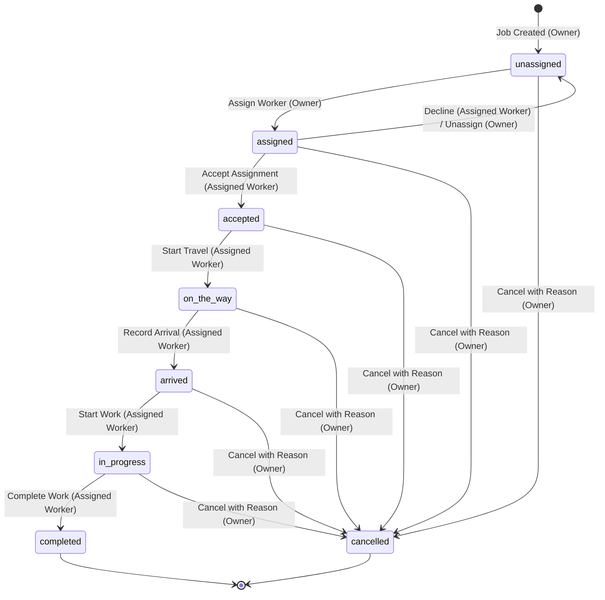

# Dispatcher — Product Specification

**Status:** FROZEN M0 BASELINE  
**Authoritative Document:** `docs/product-specification.md`  
**Target Platform:** Mobile (iOS & Android via Expo / React Native) + Customer Web Tracking Page  
**Last Updated:** M0 Specification Completion  

---

## 1. Product Overview

**Dispatcher** is a mobile-first dispatch and job-execution system designed for small local service businesses (e.g., plumbing, electrical, HVAC, cleaning, landscaping, and field maintenance). 

Dispatcher bridges the operational gap between business owners managing dispatching, field workers executing on-site jobs, and end customers awaiting service.

### 1.1 Core Roles

| Role | Platform | Description |
| :--- | :--- | :--- |
| **Owner** | Mobile App | Manages the business, team workers, customer jobs, worker assignments, job cancellations, and live operational visibility. |
| **Worker** | Mobile App | Field technician who views assigned work and performs permitted sequential job-status transitions during service delivery. |
| **Customer** | Web Browser | Service recipient who accesses a real-time tracking web page via a non-guessable, secure link without needing a mobile app or user account. |

### 1.2 User Stories

#### Owner User Stories
- **Job Creation & Management:** As an owner, I want to create and manage service jobs containing customer contact details (name, phone number, email), service description, physical job site address, scheduled time/window, and optional internal notes.
- **Worker Assignment:** As an owner, I want to assign a job to one active worker belonging to my business so that field responsibility is clear and unambiguous.
- **Operational Visibility:** As an owner, I want to view all jobs, active workers, current job stages, and the complete recorded status history (audit trail) across my entire operation.
- **Job Cancellation & Monitoring:** As an owner, I want to cancel a job with a mandatory cancellation reason when necessary and monitor ongoing job execution in real time.

#### Worker User Stories
- **Assigned Jobs View:** As a worker, I want to view my assigned jobs, customer locations, service scopes, scheduled times, and job notes.
- **Assignment Response:** As a worker, I want to accept an assignment or decline it before acceptance if I am unavailable.
- **Status Execution:** As a worker, I want to advance the job through sequential stages (`on_the_way`, `arrived`, `in_progress`, `completed`) with a single tap.
- **Action Confirmation:** As a worker, I want immediate visual confirmation and feedback whenever a permitted action or status transition is executed successfully.

#### Customer User Story
- **Zero-Barrier Access:** As a customer, I want to open a non-guessable, secure tracking link in my web browser to track my service visit without creating an account or downloading an app.
- **Live Status Updates:** As a customer, I want to see the permitted current job status, scheduled window, and the latest status update timestamp.
- **Privacy & Security Isolation:** As a customer, I must never gain access to other customers' jobs, worker private information, internal business notes, or operational financials.

---

## 2. Job Lifecycle State Machine

The job lifecycle consists of exactly **8 frozen status values**. No intermediate or custom statuses (such as "declined", "pending", or "paused") exist. Declining an assignment is an event that returns the job to `unassigned`.

### 2.1 Frozen Status Inventory

1. `unassigned`: Job has been created but has no worker assigned.
2. `assigned`: Job has been dispatched to a specific worker and awaits worker acceptance.
3. `accepted`: Worker has confirmed and accepted the assignment.
4. `on_the_way`: Worker has begun traveling to the customer address.
5. `arrived`: Worker has arrived on-site at the service location.
6. `in_progress`: Worker has commenced the service work.
7. `completed`: Worker has finished the work. (Terminal status)
8. `cancelled`: Owner has terminated the job with a stated cancellation reason. (Terminal status)

### 2.2 Allowed Transitions & Permissions Matrix



| Current Status | Target Status | Permitted Actor | Trigger / Description | Preconditions & Validation |
| :--- | :--- | :--- | :--- | :--- |
| `unassigned` | `assigned` | **Owner** | Owner assigns job to a worker. | Worker must be active and belong to the same `business_id`. |
| `assigned` | `accepted` | **Assigned Worker** | Worker accepts the assignment. | Caller must be the assigned worker (`worker_id == job.assigned_worker_id`). |
| `assigned` | `unassigned` | **Assigned Worker** OR **Owner** | Worker declines assignment OR Owner unassigns worker. | If Worker declines: caller is assigned worker, assignment is cleared, decline event logged. If Owner: assignment is cleared. |
| `accepted` | `on_the_way` | **Assigned Worker** | Worker departs for job site. | Caller must be the assigned worker. |
| `on_the_way` | `arrived` | **Assigned Worker** | Worker arrives on-site. | Caller must be the assigned worker. |
| `arrived` | `in_progress` | **Assigned Worker** | Worker begins service work. | Caller must be the assigned worker. |
| `in_progress` | `completed` | **Assigned Worker** | Worker completes work. | Caller must be the assigned worker. Terminal state. |
| *Any nonterminal status* (`unassigned`, `assigned`, `accepted`, `on_the_way`, `arrived`, `in_progress`) | `cancelled` | **Owner** | Owner cancels the job. | Mandatory non-empty cancellation reason required. Terminal state. |

### 2.3 Terminal Statuses & Enforcement Rules

- **Terminal States:** `completed` and `cancelled` are strictly terminal in the MVP. Reopening, restarting, or transitioning terminal jobs is prohibited.
- **Declining is an Event, Not a Status:** When a worker declines an assignment, the transition is `assigned` → `unassigned`. The decline reason or timestamp is captured in the event log metadata; no `declined` status exists.
- **Rejection of Invalid Transitions:** Any attempt to perform an out-of-order transition (e.g., `assigned` → `completed`, `unassigned` → `in_progress`, or mutating a `completed`/`cancelled` job) must be rejected with a 4xx error.
- **Server-Side Enforcement:** Client-side guards are strictly for UX. All permissions, state transition validity, and business tenancy checks must be enforced authoritatively on the backend (PostgreSQL RLS / server functions).
- **Append-Only Event Recording:** Every successful status transition must generate an immutable, server-recorded event record containing:
  - `id`: Unique event UUID.
  - `job_id`: Target job ID.
  - `business_id`: Owning business ID.
  - `actor_id`: User ID of the actor initiating the transition.
  - `actor_role`: Role (`owner` or `worker`).
  - `previous_status`: Status before the transition.
  - `new_status`: Status resulting from the transition.
  - `timestamp`: UTC ISO 8601 timestamp.
  - `metadata`: JSON payload containing context (e.g., `cancellation_reason`, `decline_reason`, location coordinates if captured).

---

## 3. Core Screen Inventory (Frozen 16 Mobile Screens)

The mobile application contains exactly **16 core screens**. The customer tracking interface is a separate, responsive web page and is not counted among the 16 mobile screens.

### 3.1 Tab Navigation Architecture

- **Owner Navigation:** 5 Root Tabs — `Dashboard`, `Jobs`, `Workers`, `Live Map`, `Profile / Business Settings`
- **Worker Navigation:** 3 Root Tabs — `Today`, `Jobs`, `Profile`

```
Owner App Root
├── Tabs
│   ├── 1. Dashboard (Tab Root)
│   ├── 2. Jobs (Tab Root)
│   ├── 3. Workers (Tab Root)
│   ├── 4. Live Map (Tab Root)
│   └── 5. Profile / Settings (Tab Root)
└── Stacks / Modals
    ├── Sign In (Shared)
    ├── Owner Business Setup
    ├── Create Job
    ├── Owner Job Details
    ├── Assign Worker
    └── Worker Details

Worker App Root
├── Tabs
│   ├── 1. Today (Tab Root)
│   ├── 2. Jobs (Tab Root)
│   └── 3. Profile (Tab Root)
└── Stacks / Modals
    ├── Sign In (Shared)
    ├── Worker Invitation / Join
    └── Worker Job Details
```

### 3.2 Screen Catalog

| # | Screen Name | Role | Navigation Context | Purpose | Primary Action or Empty State |
| :-: | :--- | :--- | :--- | :--- | :--- |
| **1** | **Sign In** | Owner & Worker | Auth Stack (Unauthenticated) | Authenticate existing users via email/magic link or credentials. | **Primary Action:** "Sign In"<br>**Empty State:** Clean entry form with input validation. |
| **2** | **Owner Business Setup** | Owner | Onboarding Stack | Register business profile, company name, phone, and default operating trade during initial onboarding. | **Primary Action:** "Complete Business Setup"<br>**Empty State:** Pre-populated initial registration fields. |
| **3** | **Worker Invitation / Join** | Worker | Onboarding Stack | Accept an owner invitation code/token, confirm worker identity, and join the business team. | **Primary Action:** "Accept Invitation & Join"<br>**Empty State:** "Invalid or expired invitation" with contact owner button if code is missing/invalid. |
| **4** | **Owner Dashboard** | Owner | Owner Tab Root (1) | Real-time overview of current operations: active job counts by stage, worker availability summary, and quick dispatch access. | **Primary Action:** "+ Create Job"<br>**Empty State:** "No operations scheduled for today" with "Create Job" button. |
| **5** | **Owner Jobs** | Owner | Owner Tab Root (2) | Searchable, filterable list of all jobs across all lifecycle statuses (`All`, `Unassigned`, `Active`, `Completed`, `Cancelled`). | **Primary Action:** "+ Create Job" or filter chips<br>**Empty State:** "No jobs match this filter" with clear filter button. |
| **6** | **Create Job** | Owner | Modal / Stack from Owner Jobs / Dashboard | Form to enter customer contact info (name, phone, email), service description, job address, scheduled time window, and optional internal notes. | **Primary Action:** "Save & Dispatch Job" (or "Save as Unassigned")<br>**Empty State:** Clean structured entry form. |
| **7** | **Owner Job Details** | Owner | Stack from Owner Jobs / Dashboard / Map | Complete view of a single job: current status badge, customer details, address, assigned worker card, append-only status history, tracking link generator, and cancellation trigger. | **Primary Action:** "Assign Worker" (if unassigned) or "Reassign Worker"<br>**Secondary:** "Cancel Job" (if nonterminal)<br>**Empty State:** "Job not found". |
| **8** | **Assign Worker** | Owner | Modal / Stack from Owner Job Details | Select an active worker belonging to the business to assign or reassign to the job. | **Primary Action:** "Confirm Assignment"<br>**Empty State:** "No available workers in your business" with "Invite Worker" shortcut. |
| **9** | **Workers** | Owner | Owner Tab Root (3) | Roster of all workers in the business showing active status, phone, email, and current assignment load. | **Primary Action:** "Invite Worker"<br>**Empty State:** "No workers on your team yet" with "Invite First Worker" button. |
| **10** | **Worker Details** | Owner | Stack from Workers tab | Detailed profile of an individual worker: contact info, active assigned job, historical completed jobs count, and worker status toggle. | **Primary Action:** "Edit Worker" / "Deactivate Worker"<br>**Empty State:** "No job history recorded for this worker". |
| **11** | **Live Map** | Owner | Owner Tab Root (4) | Geographic map displaying today's job locations with status-colored pins and worker locations across the operating territory. | **Primary Action:** Tap pin to open job summary card<br>**Empty State:** "No active jobs with locations for today". |
| **12** | **Owner Profile / Business Settings** | Owner | Owner Tab Root (5) | Manage company profile, operating hours, notification preferences, team settings, and session sign out. | **Primary Action:** "Save Changes" / "Sign Out"<br>**Empty State:** Populated business configuration form. |
| **13** | **Worker Today** | Worker | Worker Tab Root (1) | Daily execution dashboard for the field worker showing current or next scheduled job with a prominent, large one-tap status advancement button. | **Primary Action:** One-tap contextual transition action (e.g., "Accept Job", "On The Way", "Mark Arrived", "Start Work", "Complete Work")<br>**Empty State:** "You're all caught up! No jobs scheduled for today." |
| **14** | **Worker Jobs** | Worker | Worker Tab Root (2) | List of all jobs assigned to the worker, partitioned by `Upcoming`, `In Progress`, and `Past Completed`. | **Primary Action:** Tap job card to view details<br>**Empty State:** "No assigned jobs found". |
| **15** | **Worker Job Details** | Worker | Stack from Worker Today / Worker Jobs | Full job execution screen: customer address with "Open in Maps" launcher, customer phone with "Call Customer" launcher, work scope, notes, and the next permitted lifecycle action button. | **Primary Action:** Next permitted lifecycle button<br>**Secondary Action:** "Decline Assignment" (visible only in `assigned` status)<br>**Empty State:** "Job details unavailable". |
| **16** | **Worker Profile** | Worker | Worker Tab Root (3) | Worker account details, notification preferences, app version information, and session sign out. | **Primary Action:** "Sign Out"<br>**Empty State:** Populated worker profile card. |

---

## 4. Customer Tracking Web Page (Separate Surface)

The Customer Tracking Web Page is a dedicated, public-facing, responsive web interface. It is **not** one of the 16 mobile screens and does not require an account or app installation.

### 4.1 Access & Authorization
- **Token-Based URL:** Accessed via `https://<domain>/track/:tracking_token`.
- **Security:** The `tracking_token` is an unpredictable, cryptographically secure 128-bit UUID or high-entropy nano-id generated upon job creation.
- **Zero Authentication:** No customer login, password, or cookies required.
- **Rate-Limiting & Validation:** Invalid or expired tokens return a friendly error page. Requests are rate-limited to prevent brute-force token enumeration.

### 4.2 Customer Visible Information
- **Business Identity:** Company name, business logo, customer support phone number.
- **Service Summary:** Scheduled service type and scheduled arrival window.
- **Current Job Status:** User-friendly translated status:
  - `unassigned` / `assigned` → *"Scheduled"*
  - `accepted` → *"Confirmed — Preparing for your visit"*
  - `on_the_way` → *"Technician is on the way"*
  - `arrived` → *"Technician has arrived on-site"*
  - `in_progress` → *"Work is currently in progress"*
  - `completed` → *"Service completed"*
  - `cancelled` → *"Service cancelled"*
- **Assigned Worker:** Worker first name and profile avatar (no personal phone, email, or worker private metadata).
- **Latest Update:** Timestamp of the most recent status transition.

### 4.3 Strictly Excluded Customer Data
- Customer tracking links must **never** reveal:
  - Other customers' jobs or identities.
  - Worker personal phone numbers or direct contact channels (calls route through business support).
  - Internal business notes, worker dispatch logs, or job profit/margins.
  - Other business settings or system identifiers.

---

## 5. Explicit MVP Scope Boundaries

To ensure rapid delivery, operational reliability, and architectural clarity, the boundaries of the Minimum Viable Product (MVP) are frozen.

### 5.1 In-Scope Capabilities (MVP Requirements)
1. **Job Lifecycle Management:** Complete 8-status progression (`unassigned` through `completed` or `cancelled`).
2. **Role-Based Workflows:** Distinct UI and permissions for Owner and Worker personas.
3. **Dispatch & Assignment:** Manual assignment and reassignment of jobs to a single worker in the same business.
4. **Execution Audit Trail:** Immutable, server-side append-only recording of all job lifecycle transitions with timestamps and actor attribution.
5. **Customer Link-Based Tracking:** Secure, web-based, real-time tracking page accessed via token.
6. **Communication Foundations:** Native device intents for one-tap calling (`tel:`) and turn-by-turn navigation (`maps:` / Google Maps / Apple Maps).
7. **Basic Billing Readiness:** Data model support for estimated price, quoted hours, and final labor hours to prepare for future invoicing integration.

### 5.2 Out-of-Scope Capabilities (Explicit Exclusions)
The following capabilities are **strictly excluded** from the MVP:
- **AI / Algorithmic Scheduling:** No automated dispatch algorithms, AI recommendations, or dynamic schedule rebalancing.
- **Payroll & Wage Calculation:** No timesheet calculation, overtime tracking, worker pay rates, or payroll exports.
- **Invoicing & Payments:** No payment gateway integration (Stripe, Square), payment collection on mobile, or tax invoices.
- **Inventory & Parts Management:** No parts tracking, van inventory stock, or purchase orders.
- **Full CRM Features:** No marketing campaigns, sales funnels, review requests, or customer lead generation.
- **Automatic Route Optimization:** No multi-stop automated TSP route solving (workers navigate job-by-job via native maps).
- **Independent Customer Mobile App:** No native iOS/Android app for customers (customer experience is exclusively the web tracking link).
- **Multi-Worker Job Assignment:** No split jobs, crew assignments, or multi-worker collaboration on a single job.
- **Multi-Business Membership:** Users belong to exactly one business tenant.
- **Automated SMS & Third-Party Messaging (Phase M14 — DEFERRED):** No Twilio packages, automated SMS dispatch, or carrier webhooks; customer tracking links are shared manually via clipboard and native share launcher.

> [!IMPORTANT]
> Mentioning future-phase concepts (such as billing readiness or map coordinates) in this specification does not mean they are implemented in the MVP. Scope creep will be rejected.

---

## 6. Architecture, Tenancy & Security Rules

All implementations across mobile and backend must conform to these non-negotiable architectural invariants:

1. **Strict Business Tenancy:** Every job, worker, and customer record belongs to exactly one business (`business_id`). Cross-business access is strictly prohibited.
2. **Single Assigned Worker:** A job has at most one assigned worker at any given time (`assigned_worker_id` nullable, foreign key to workers).
3. **Same-Business Worker Invariant:** A worker assigned to a job must belong to the exact same business as the job (`worker.business_id == job.business_id`).
4. **Server-Enforced Isolation:** Business isolation and role-based permissions must be enforced authoritatively on the backend using PostgreSQL Row Level Security (RLS) and server constraints. Client-side checks are strictly UI enhancements.
5. **Append-Only Status History:** The `job_events` status history is strictly append-only from the application layer. No client or routine application API may update or delete event log records.
6. **Secure Customer Tracking Tokens:** Tracking tokens must be high-entropy, unpredictable tokens (e.g. UUIDv4 or nano-id) generated server-side. Validation queries must only expose safe, sanitized customer tracking views.
7. **Database Schema Governance:** No database tables, columns, or relations may be created without documentation in this specification and a reviewed migration in `supabase/migrations/`.
8. **Client Secret Hygiene:** Never include privileged server keys (e.g. Supabase `service_role` key, database passwords, private encryption secrets) in mobile application bundles. The mobile client must only use public anonymous client keys.
9. **No Fake Business Data:** Do not invent mock datasets that violate the single-business or status transition invariants. Mock data used during Phase 1 UI testing must strictly mirror the frozen lifecycle and schema models.

---

## 7. Acceptance Criteria & End-to-End Success Flows

### 7.1 Primary End-to-End Acceptance Flow (Happy Path)
1. **Creation:** Owner opens Create Job screen, enters customer contact, service details, address, and scheduled window. Job is created in `unassigned` status.
2. **Assignment:** Owner opens Assign Worker modal and selects Worker A (belonging to same business). Job transitions to `assigned`. Server records `assigned` event with Owner actor ID.
3. **Acceptance:** Worker A views assigned job on Worker Today screen and taps "Accept". Job transitions to `accepted`. Server records `accepted` event with Worker actor ID.
4. **Travel:** Worker A taps "On The Way". Job transitions to `on_the_way`. Server records `on_the_way` event.
5. **Arrival:** Worker A arrives on-site and taps "Arrived". Job transitions to `arrived`. Server records `arrived` event.
6. **Execution:** Worker A commences service and taps "Start Work". Job transitions to `in_progress`. Server records `in_progress` event.
7. **Completion:** Worker A completes service and taps "Complete Work". Job transitions to `completed`. Server records `completed` event.
8. **Owner Verification:** Owner opens Owner Job Details screen and verifies all 7 events appear in exact chronological sequence with accurate timestamps, status badges, and actor attribution.
9. **Customer Verification:** Customer tracking web page displays the updated status throughout the flow without authentication and without exposing unauthorized business or worker data.

### 7.2 Secondary Acceptance Flow: Worker Assignment Decline
1. Owner assigns Job to Worker A (`assigned` status).
2. Worker A taps "Decline Assignment" with an optional note before accepting.
3. Job transitions from `assigned` → `unassigned`.
4. Assigned worker is cleared (`assigned_worker_id = null`).
5. Server records decline event in append-only log with Worker actor ID and note.
6. Job appears in Owner Jobs under `Unassigned` tab ready for reassignment.

### 7.3 Secondary Acceptance Flow: Owner Job Cancellation
1. Job is in any nonterminal state (`unassigned`, `assigned`, `accepted`, `on_the_way`, `arrived`, or `in_progress`).
2. Owner opens Owner Job Details and taps "Cancel Job".
3. Owner enters mandatory non-empty cancellation reason.
4. Job transitions to `cancelled`.
5. Server records `cancelled` event with Owner actor ID and cancellation reason metadata.
6. Job is locked in terminal status: no further transitions permitted for Owner or Worker.
7. Assigned worker receives cancellation notice and job is removed from active Today queue.
8. Customer tracking web page updates status to *"Service cancelled"*.

### 7.4 Negative Test Cases
- **Invalid Transition Attempt:** Worker attempting to move directly from `assigned` to `completed` or `unassigned` to `in_progress` is rejected with an error.
- **Terminal Mutation Attempt:** Attempting to alter a `completed` or `cancelled` job returns a terminal state error.
- **Cross-Business Assignment:** Attempting to assign a worker from Business X to a job in Business Y fails server validation.
- **Unauthorized Role Action:** Worker attempting to cancel a job or assign another worker is denied with a 403 Forbidden error.
